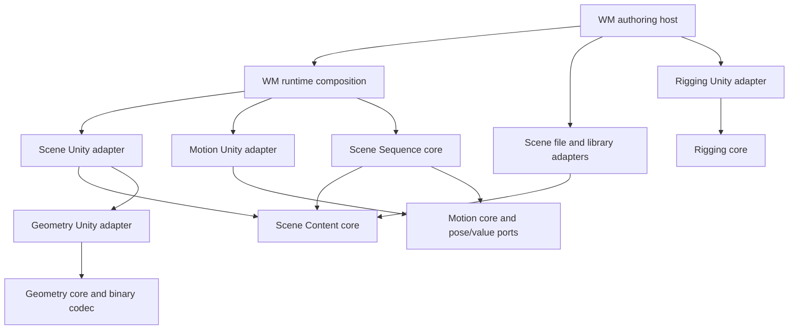

# Content module boundaries

The content system is built from engine-independent data and algorithms, explicit host ports, and replaceable adapters. WM composes the modules. A module does not locate a game singleton, discover a source installation or invoke an editor from its core.

| Module | Owns | Host supplies |
|---|---|---|
| Appearance | Named color channels and validated palette application | Color target and semantic mapping |
| Geometry | Vertex attributes, skin weights, bind poses and sparse morph frames | Storage and engine mesh creation |
| Scene Content | Node graph, surface recipes, resource identities, camera/light data, cloning/composition/pruning | Resource source, surface factory and rendering policy |
| Motion | Pose/value keys, deterministic sampling, recording/removal and key navigation | Pose/value targets, stable property identities and clock |
| Rigging | Role bindings and analytic limb geometry | Joint data, bend goals and hierarchy policy |
| Scene Sequence | Scene and motion composition, binding conflicts and export manifest | Resource source, playback host and semantic property validation |
| Snapshot History | Bounded snapshots, undo/redo and history commit after successful application | Typed serialization and transactional state application |

The cores do not reference Unity, WM or editor assemblies. Serialization, file storage and Unity construction are separate assemblies. The portable example compiles the same core files into a normal .NET program. Rendering and asset-lifetime tests remain Unity tests.

`IContentSource` supplies resource bytes. `ISurfaceFactory` creates new owned engine materials. `IPoseTarget` binds local poses. `IValueTarget` validates and writes numerical properties. Targets are resolved and semantic bounds checked before a motion frame is applied. Host callbacks must be synchronous and avoid side effects while resolving or validating.

Scene documents own rendered surface values. A separate appearance palette is an optional semantic input, not a second synchronized material store. A host may apply a palette through its own mapping; automatic coupling is not assumed.

Stable IDs identify nodes independently of display names. Composition gives added actors their own namespace and rewrites all indices and references. Resource identity is based on content hashes; aliasing the same resource does not allocate another runtime mesh or texture within a loaded scene. The disk library shares identical bytes across scene variants.

Loaded scene instances own generated assets. Runtime composition stages content inactive and exposes it after construction and clip binding succeed. Failed construction disposes staged content. Unloading hides content immediately, then Unity releases its owned objects. Imported data never changes project quality silently; skin influence requirements are checked against host policy.

The authoring preview is separate from the game's active scene. Working drafts and motion state are checkpointed locally without copying model blobs. Export uses validated resources and atomic manifest replacement. Rig sidecars are composed by the WM host and are kept separate from the common scene module.

Scene structural edits and motion key edits share `SnapshotHistory<T>`. The host supplies codecs; the module knows neither document schema nor engine objects. A failed staged application leaves both history stacks unchanged. The host is responsible for staging its own change before replacing live state. The state count and combined character budget bound both undo and redo storage. Checkpoints and undo history have different lifetimes; reopening restores drafts, not the previous undo stacks.

Sequence export embeds the native scene and motion documents, then uses the content library adapter to share hash-addressed resources. A sequence owns no renderer or clock. Pose targets must exist in its scene and clips cannot compete for a target. Numerical property meaning remains a host contract; the runtime stages the scene and validates property bindings before activation. Runtime supports multiple clips starting together; the authoring host currently exports one combined clip. This does not imply a general timeline scheduler or mixer.

These are building contracts, not a frozen interchange standard. The current design does not yet include a general constraint graph, secondary dynamics, event/audio scheduling, rig retargeting, semantic body parameters or a general shader graph. Add those as explicit capabilities with data ownership and execution order; do not route them through untyped compatibility payloads.
